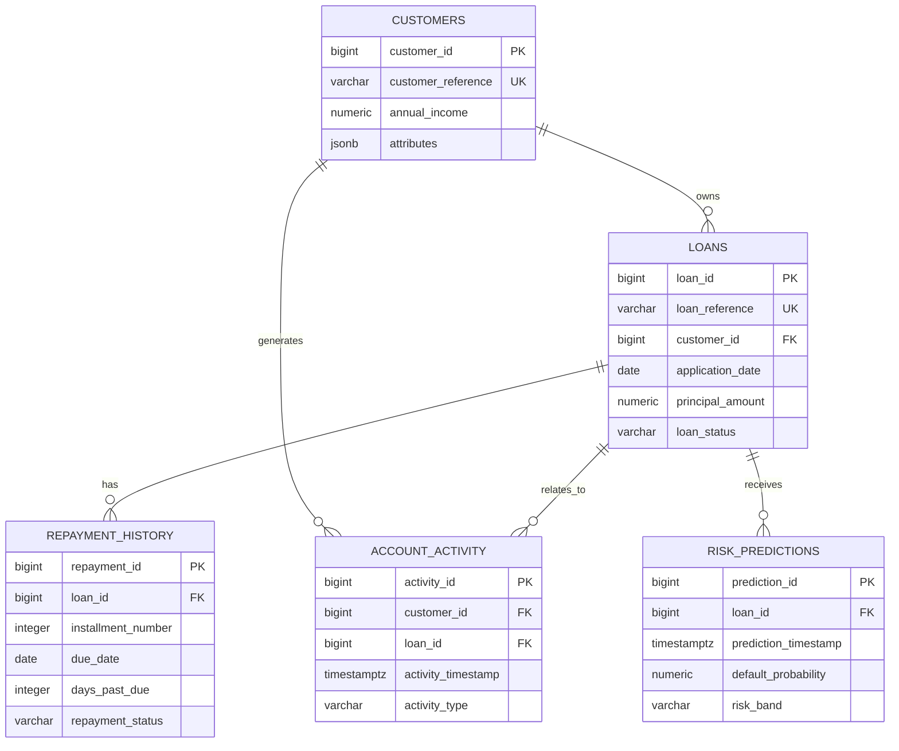

# PostgreSQL Database

## Local configuration

The development database uses PostgreSQL 18 on `localhost:5432`. Application
credentials live in the ignored `.env` file. The tracked `.env.example` contains
only placeholders.

Create a local `.env` when one does not already exist:

```powershell
Copy-Item .env.example .env
```

Set a unique password and keep the database listening on localhost for local
development. Do not commit credentials or expose port 5432 publicly.

## Entity relationships



`schema_migrations` records each applied migration and its SHA-256 checksum. An
applied migration must never be edited. Add a new numbered migration instead.

## Apply migrations

```powershell
.\.venv\Scripts\python.exe -m src.migrations up
.\.venv\Scripts\python.exe -m src.migrations status
```

The migration runner uses a PostgreSQL advisory lock, applies migrations in
version order, validates checksums, and wraps each run in a transaction.

For `psql`, `sql/schema.sql` is a convenience entry point that includes the
versioned scripts. The Python runner is the normal application workflow.

## Test connectivity and schema

Run unit tests:

```powershell
.\.venv\Scripts\python.exe -m pytest -q
```

Run the PostgreSQL integration test against the configured local database:

```powershell
$env:RUN_POSTGRES_TESTS="1"
.\.venv\Scripts\python.exe -m pytest tests/test_database_integration.py -q
```

The integration test inserts a customer, loan, repayment, account activity, and
risk prediction inside a forced-rollback transaction, then verifies a relational
query. Test records do not persist.

## Operational rules

- Use `customer_reference`, `loan_reference`, and `source_event_reference` for
  upstream identifiers; use generated numeric keys for internal relationships.
- Store timestamps with time zones and provide UTC values from applications.
- Use `NUMERIC`, not floating point, for money and probability values.
- Store only non-core extensible attributes in JSONB.
- Preserve repayment and prediction history; do not overwrite prior events.
- Use least-privilege application credentials rather than the PostgreSQL
  superuser.
