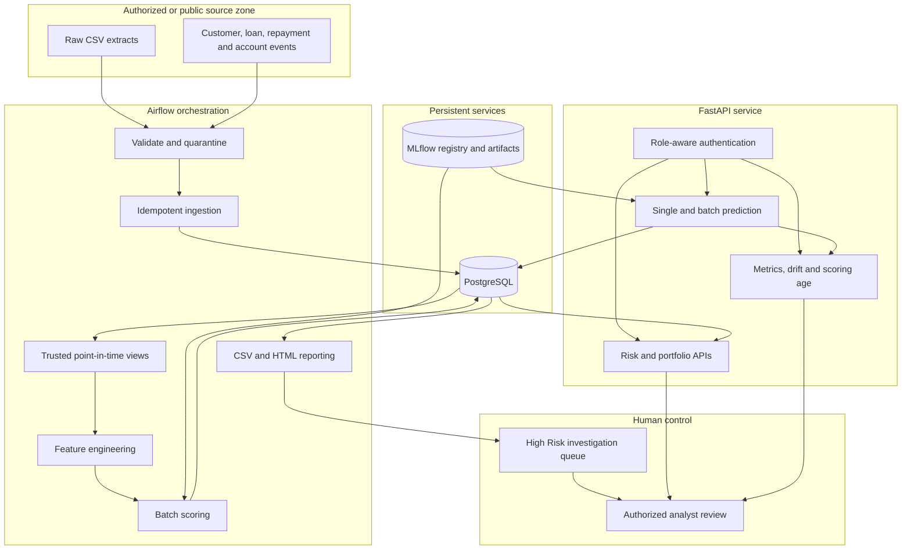
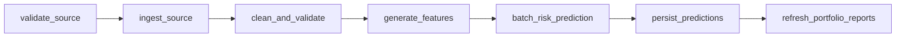
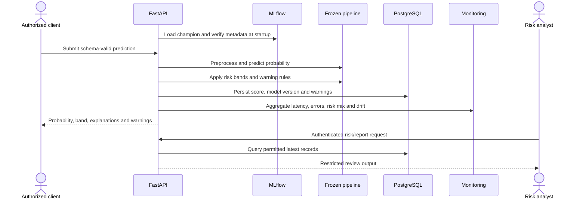

# Final architecture and workflow diagrams

## Runtime architecture

## Daily batch workflow

Every logical run derives an idempotency key from its date and source hash.
Retries may update source records but cannot create a second scoring result set
for the same key.

## Online prediction and review sequence

## Trust boundaries

- Secrets stay in environment configuration and are excluded from Git.
- Containers communicate on the Compose network; only configured host ports are
  exposed for local development.
- Raw inputs and feature snapshots are excluded from structured logs.
- Account-level reports require `risk_analyst` or `admin`; aggregate and
  monitoring access use separate roles.
- Model output supports manual review and never directly approves or declines a
  loan in this project.
